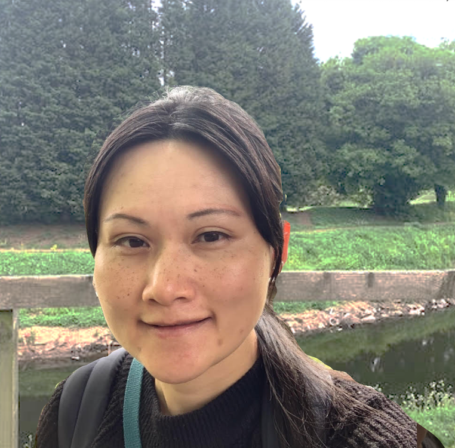

---
layout: default
title: "Home"
---

<!-- GOOGLE FONTS -->
<link rel="preconnect" href="https://fonts.googleapis.com">
<link rel="preconnect" href="https://fonts.gstatic.com" crossorigin>
<link href="https://fonts.googleapis.com/css2?family=DM+Sans:wght@400;500;600;700&family=Manrope:wght@400;500;600;700;800&display=swap" rel="stylesheet">

<!-- LEAFLET MAP -->
<link rel="stylesheet" href="https://unpkg.com/leaflet@1.9.4/dist/leaflet.css">

<!-- =========================================
     HERO / PROFILE
     ========================================= -->

  

  <h1>An Yu Chen</h1>

  

    Innovation Policy &amp; Sustainability Research |
    Science of Science |
    PhD in Science, Technology and Innovation Policy (Completed)
  

  

    I am currently working on research projects related to innovation policy,
    sustainability, environmental economics, and the management of science
    and technology. My research examines the use and exchange of operant
    resources among governments, academic institutions, and private firms,
    drawing upon data from sources including Web of Science, Scopus, and
    USPTO databases. I aim to continue making a positive impact through
    excellent research and teaching. Please explore the Research and
    Teaching sections in the menu for further information. You can always
    return to this main page by clicking my name, “An Yu Chen,” in the top
    left corner.
  

<!-- =========================================
     CV & AUTOBIOGRAPHY
     ========================================= -->

  <a
    href="assets/CV.pdf"
    target="_blank"
    rel="noopener noreferrer"
    class="btn btn-primary"
  >
    View CV ↗
  </a>

  <a
    href="https://an-yu-chen.github.io/academic.website/autobiography/"
    class="btn btn-secondary"
  >
    Autobiography →
  </a>

<!-- =========================================
     ACADEMIC MILESTONE TIMELINE
     ========================================= -->

  <h2>Academic Milestone Timeline</h2>

  

    

      
September 2026

      Contributed to WIPO’s <em>Women, Innovation and Impact</em> booklet

        

      <a
        href="https://www.wipo.int/publications/en/details.jsp?id=4879"
        target="_blank"
        rel="noopener noreferrer"
      >
        View the WIPO publication →
      </a>

    

    

      
2025–2026

      Research Associate in Science of Science, University of Manchester

    

    

      
2021–2026

      PhD in Science, Technology and Innovation Policy, University of
      Manchester (Completed)

       
      • Supervisors: Professor Cornelia Lawson and Professor Silvia Massini

       
      • PhD Viva Examiners: Professor Kieron Flanagan and Professor Fabio
      Montobbio

    

    

      
2018–2020

      Assistant Editor, Taiwan Hsinchu Industry and Management Forum
      (Innovation journal publication support and editorial work)

    

    

      
2017–2020

      Research Assistant, Government Science and Technology Policy Projects
      (MOST, Taiwan)

       
      • Analysis of national S&amp;T policy frameworks

       
      • Evaluation of Taiwan’s science and technology development plans

    

    

      
2018

      First academic conference presentation: PICMET (Portland International
      Conference on Management of Engineering and Technology), Honolulu, USA

    

    

      
2016–2017

      Booking.com — Industry Experience (E-commerce &amp; Tourism Analytics)

    

    

      
2015

      DAAD Research Internship, Otto-von-Guericke University Magdeburg

       

      Focus: Human-centered design and emotional product development

    

    

      
MSc

      MSc in Technology Management, National Tsing Hua University
      (Institute of Technology Management)

    

    

      
Early Academic Formation

      Bachelor’s studies in Economics (Arts &amp; Economics background)

       

      Developed early interest in data, policy, and innovation systems

    

  

<!-- =========================================
     RESEARCH INTERESTS
     ========================================= -->

  <h2>Research Interests and Areas of Practice</h2>

  

    <ul>

      <li>
        Economics of Innovation with a focus on technological change,
        knowledge creation, and the dynamics of emerging industries
      </li>

      <li>
        Science, Technology &amp; Innovation Policy examining research
        ecosystems
      </li>

      <li>
        Green Technologies and Sustainable Innovation addressing
        environmental transitions
      </li>

      <li>
        Critical reflection on AI, systems, and contemporary digital life
      </li>

      <li>
        Digital Transformation of Science analysing the impact of digital
        infrastructures, computational methods, and intelligent technologies
        on scientific practice, collaboration, and innovation processes
      </li>

    </ul>

  

<!-- =========================================
     CONNECT WITH ME
     ========================================= -->

  <h2>Connect with Me</h2>

  

    If you'd like to get in contact with me you can find my LinkedIn or
    via my email
  

  

<!-- =========================================
     ACADEMIC NETWORK & GLOBAL EXPERIENCE
     ========================================= -->

  <h2>Academic Network &amp; Global Experience</h2>

  

<!-- =========================================
     LEAFLET MAP SCRIPT
     ========================================= -->

